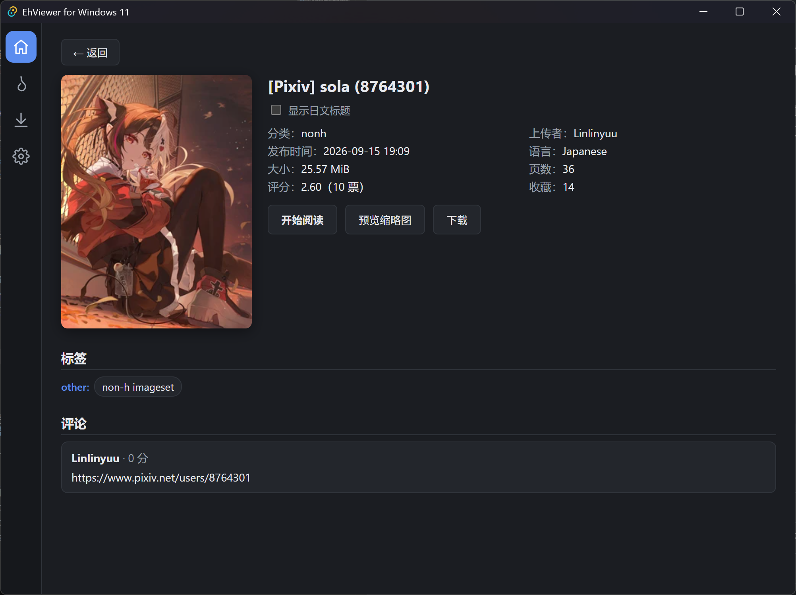
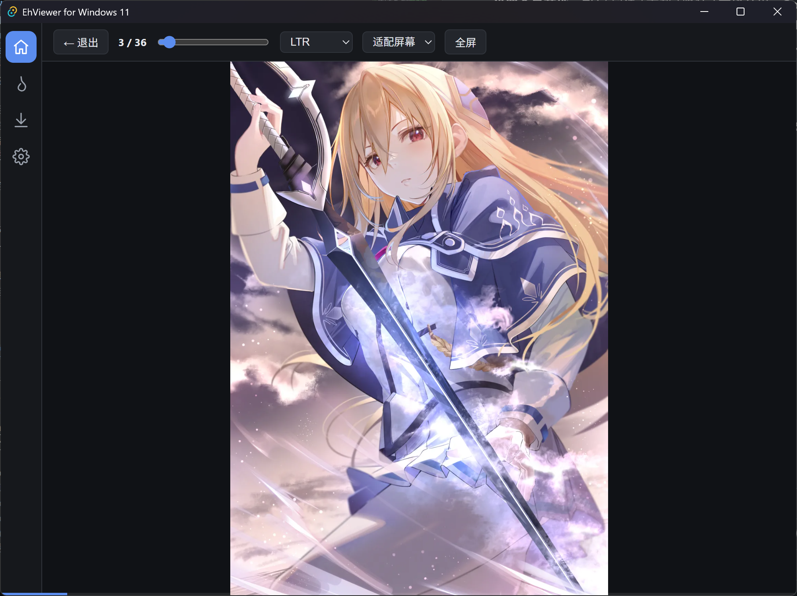
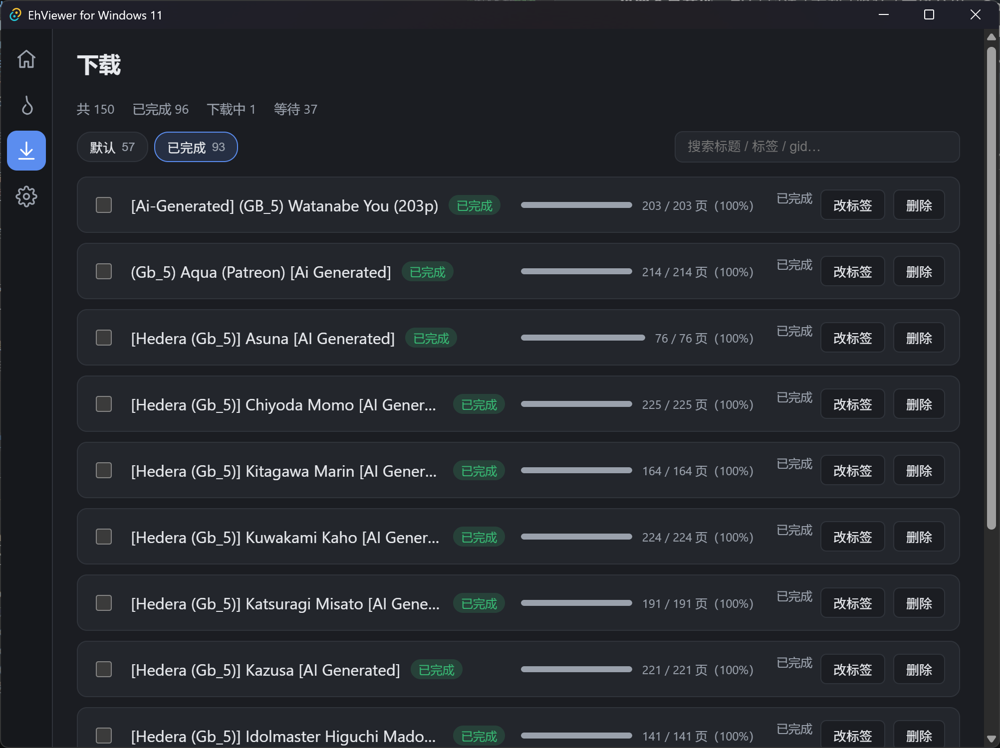
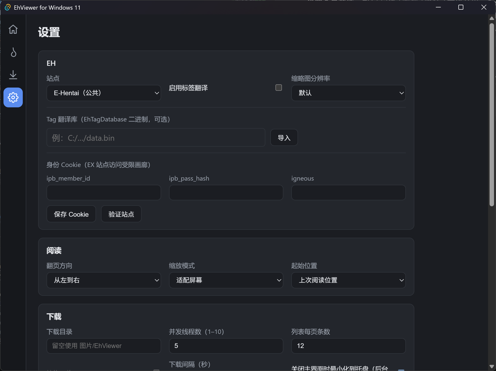

# EhViewer for Windows 11

[](#)
[](#)
[](#)
[](#)
[](#)

> 基于 Tauri v2、Rust、React 和 TypeScript 实现的 E-Hentai Windows 11 桌面客户端。以 Ehviewer_CN_SXJ 的 Android 行为为参考，保留核心功能并适配桌面交互。

## 作者碎碎念（置顶）

- 为什么做这个项目：
  因为节点不干净，进不了里站，被下载缺页搞得强迫症爆发，设置下载超时时间后亦无法解决。遂chat coding出这个项目，选windows11桌面端方便后台下载，然后优化下载超时时间防止卡死（0B/s），再给下载队列加循环，解放双手。就是这样捏。

## 界面预览

| 主页 | 详情 + 侧栏 | 阅读器 | 下载 | 设置 |
| --- | --- | --- | --- | --- |
|  |  |  |  |  |

## 功能

- **浏览与阅读**：主页、热门、搜索、分类、详情、缩略图预览和在线阅读器；支持搜索记录单项删除与热门页刷新。
- **阅读器**：横/纵向阅读、缩放、快捷键、全屏、进度续读、预加载、缩略图跳转和页面旋转。
- **后台下载**：并发下载、断点续传、超时/509 重试、暂停恢复、重启还原和实时进度。
- **下载管理**：可配置分页（默认 9 条）、按标签分目录、已完成归档、批量操作，以及队内/队外 `[作者] 标题` 目录重命名。
- **网络适配**：系统 DNS、DoH、内置 IP、代理、自定义 Host、镜像白名单和网络诊断。
- **桌面集成**：单实例、托盘常驻、Windows DPAPI Cookie 加密和设置持久化。

## 快速开始

环境要求：Windows 11（含 WebView2）、Node.js ≥ 22、pnpm、Rust MSVC 工具链。

```bash
pnpm install
pnpm tauri dev
```

## 测试与打包

```bash
# 后端串行测试（当前基线：101 项）
cd src-tauri
cargo test --lib -- --test-threads=1
cd ..

# 前端构建（当前基线：47 个模块）
pnpm build

# 安全构建 NSIS 安装包（移除本机路径并检查泄漏）
pnpm build:release
```

安装包输出到 `src-tauri/target/release/bundle/nsis/`。默认并行后端测试仍有 DNS 全局状态隔离问题，建议使用串行命令。

## 网络说明

默认使用系统 DNS，并在冷启动时启用 DoH/内置 IP；连接失败会自动升级解析策略。设置中的“网络诊断”可区分 DNS 污染与 SNI/DPI 阻断，也可配置 HTTP/SOCKS5 代理、自定义 Host 和镜像白名单。

## 开发状态

Phase 0–6 功能主体已完成，目前处于发布验收阶段。安全导出、Cookie 加密失败关闭和隐私化 release 构建已接入；剩余工作集中在真实站点端到端测试、最新安装包验收、DNS 测试隔离、代码签名和 UI 细节收尾。

## 文档与许可

- 功能对位说明：[`docs/parity-map.md`](docs/parity-map.md)
- 开发交接：[`docs/skill-handoff.md`](docs/skill-handoff.md)
- 安全说明：[`SECURITY.md`](SECURITY.md)
- License：[GPL-3.0](LICENSE)

本项目仅以 Ehviewer_CN_SXJ 的行为为参考进行桌面重实现，未移植其源码。

## 免责声明

本项目仅供学习与个人使用。使用时请遵守适用法律法规及 E-Hentai 服务条款，避免高并发抓取或滥用。如涉及侵权，请及时联系下架。
